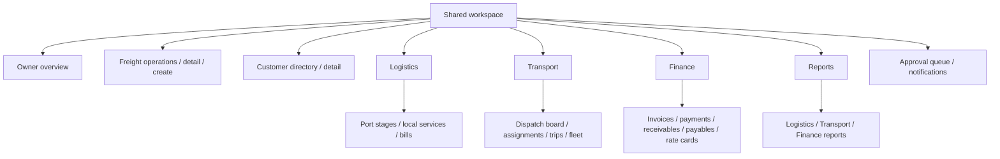
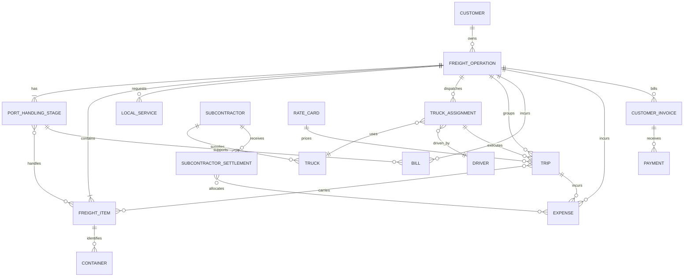
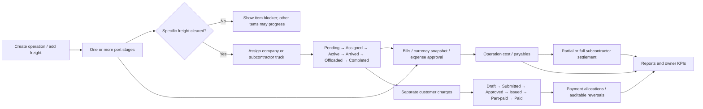

# Freight ERP — architecture proposal

All data and amounts in the prototype are illustrative. No backend, authentication, or real authorization is implemented. Changes live in React state for the current browser session and reset on refresh. The selected role demonstrates access; it is not a security boundary.

## 1. Module map and navigation



## 2. Role-to-screen and action matrix

Officers have view/create/edit/submit permissions only within their assigned work area:
- External Logistics Officer: assigned port stages; Internal Logistics Officer: assigned local clearance tasks.
- Transport Officer / Dispatcher: assigned requests, assignments and trips.
- Finance Officer / Accountant: assigned bills, draft invoices, expenses, payments, payables and settlements.

Logistics Manager normally approves External and Internal submissions; Transport Manager approves Transport submissions; Finance Manager approves Finance submissions. Managers see all department records, assign staff, and create/edit Draft or Returned department work. No person may approve records they created or submitted. Manager-originated submissions escalate to General Manager or another independently authorized approver. Admin is not a financial approver merely by being an administrator.

Officers edit only Draft or Returned records. Deletion requires their own unused Draft, zero dependent documents/transactions, and no submission history. Submitted, Approved, Issued, Paid, Settled and Voided records cannot be deleted. Returns require a reason; corrections/reversals/void requests retain the original record and audit trail. Officers cannot approve.

Queues display record, operation, supporting document metadata, submitter, amount and full history, with Approve/Return actions. Assigned-work tabs expose Draft, Submitted, Approved and Returned states and the next permitted action. Print uses the same scoped record and history as the screen. Department reports and search share assignment visibility; the four centered module menus remain visible, while inaccessible pages are restricted.

Prototype: each preview role maps to an illustrative person (not a login). External Meron Tadesse, Internal Abel Girma, Transport Abebe Alemu, Finance Selam Abebe; department managers are illustrative Hana Tesfaye, Tesfaye Bekele and Dawit Mekonnen. Assigned operations/stages are sample allocations. Switching roles clears view filters but retains session-local work. Refresh resets everything.

Approval and operational/financial lifecycle states are independent. New entry forms save Draft work rather than posting immediately. Approved invoices can be issued; approved payment/settlement requests can be posted with balance revalidation. Port-stage, assignment, bill and correction requests retain their approval in the shared work register; execution of those approved requests remains a separate future process. Document names are illustrative metadata, not uploaded file bytes.

## 3. Entities and relationships



- **Customer:** id, legal name, contact, billing address, tax identifier, terms.
- **Freight Operation:** id/unique reference, customerId, opening date, origin, destination, overall status, responsible user, freight items. One or more independent port stages; origin is not fixed to Djibouti.
- **Port Handling Stage:** operationId, sequence, configurable port/country, arrival/clearance/release dates, stage status, approver, responsible staff. Stage-to-item readiness and blocker records permit dispatch of cleared items before other stages finish.
- **Freight Item / Container:** type, size, quantity, gross weight, unit, container number where relevant, origin/destination, readiness. Container numbers are unique among active movements, not forever.
- **Truck / Subcontractor / Driver:** fleet ownership company/subcontractor, subcontractorId if external, registration, capacity, trailer, availability, licence validity.
- **Truck Assignment:** operationId, item allocations, requested truck count, truckId/driverId/trailerId, assignment state. Capacity and conflicting bookings must be validated by the backend.
- **Trip:** operationId, assignmentId, allocated items, departure/arrival/delivery/offload dates, state, customer charge, cost, currency/rate snapshot, demurrage/penalties, proof of delivery.
- **Bill / Expense:** operationId, optional stageId/tripId, supplier, category (configurable for local services), original currency/amount, locked exchange rate/date/source, ETB amount, approval/payment status, supporting document.
- **Rate Card:** company or subcontractor, lane, freight type, currency, rate, validFrom/validTo; snapshot selected rate onto trip to protect history.
- **Customer Invoice:** operationId, immutable issued number/date/line items, currency, tax, due date, Draft/Issued/Part-paid/Paid/Void/Credited status.
- **Payment:** immutable receipt/reference, date, amount/currency, allocation rows against invoices, settlement status. Partial allocations supported; overpayment needs unapplied credit policy.
- **Subcontractor Settlement:** supplierId, expense allocation rows, paid amount, date, reference, status. Partial settlements supported.
- **Document / Activity / Approval:** parent kind/id plus operationId, metadata, actor, timestamp, before/after, correction reason. Actual uploaded bytes require future storage; prototype holds file names only.

Revenue and cost use separate ledgers. Prototype estimated profit = customer charges − approved costs, excluding unapproved costs, tax, FX revaluation and overhead. Cash received is not revenue. Report all amounts in ETB; foreign original amounts and transaction exchange rates remain visible.

## 4. Operation workflow



Overall operation states: Draft → In progress → Delivered → Closed, with On hold/Cancelled as controlled exceptions. Stages, freight readiness, assignments, trips, invoices and payments keep independent states. Closing requires completed required work, reconciled documents and the configured finance close policy; unpaid invoices do not automatically prohibit operational delivery. Cancelled trips must release allocations. These transitions are proposals, not final accounting rules.

## 5. Screen inventory and frontend structure

| Route | Screen and purpose |
|---|---|
| `/` | Owner overview: KPIs, revenue/cost chart, attention queue, recent operations, active routes |
| `/operations` | Search/filter operations and create multi-stage operation |
| `/operations/$operationId` | Overview, Logistics, Transport, Finance, Documents, Activity tabs and timeline |
| `/customers` | Searchable customer directory and contact/balance detail |
| `/logistics` | Stage list, selected-stage dates/bills, charge and local service entry |
| `/transport` | Dispatch board with freight blockers and assignment form |
| `/trips` | Searchable trips and trip detail with lifecycle/POD metadata |
| `/fleet` | Company/subcontractor trucks, drivers and availability |
| `/finance` | Consolidated costs, customer charges, invoice/payment/settlement actions |
| `/invoices` | Invoice list, printable invoice preview and partial payment form |
| `/payables` | Subcontractor obligations, aging and partial settlements |
| `/rates` | Company/subcontractor lane rate cards with effective dates |
| `/approvals` | Pending bills/expenses, department submissions, approve/return with history and mandatory return reason |
| `/reports` | Logistics/Transport/Finance report tabs, date/customer/operation/status filters, CSV and print-to-PDF |

Root shell wraps all routes in a session-local `WorkspaceProvider`. `src/features/erp/model.ts` holds typed illustrative records, independent state and pure calculations; `store.tsx` holds prototype actions; `shell.tsx` holds role-aware navigation/search; `ui.tsx` holds shared badges/tables/forms; focused screen files render each module. Leaf routes own unique metadata. No server calls or credentials. Browser print provides printable views and Save as PDF; CSV export downloads the filtered rows.

## 6. Proposed API resources (not implemented)

Authenticated `/api/v1/customers`, `/operations`, `/operations/:id/stages`, `/freight-items`, `/containers`, `/trucks`, `/drivers`, `/subcontractors`, `/assignments`, `/trips`, `/bills`, `/expenses`, `/rate-cards`, `/invoices`, `/payments`, `/settlements`, `/approvals`, `/documents`, `/activity`, `/reports`.

All resources use tenant-scoped IDs, pagination, filtered reads, validated schema, permissions, idempotency keys for finance mutations and optimistic version checking. Approval endpoints check actor and submitter independently. Never trust the browser-selected role. Finance changes and audit events commit atomically; database constraints ensure every child resolves to the same operation.

```json
POST /api/v1/operations
{"customerId":"cus-001","origin":"Shanghai, CN","destination":"Addis Ababa, ET","freightItems":[{"type":"40ft container","quantity":2,"weightKg":42000}],"stages":[{"port":"Shanghai","sequence":1},{"port":"Djibouti","sequence":2}]}
201 {"id":"op-001","reference":"RZ-2026-1048","status":"Draft","version":1}

POST /api/v1/operations/op-001/bills
{"stageId":"stage-001","originalAmount":2400,"currency":"USD","exchangeRate":132.50,"rateDate":"2026-11-12","rateSource":"approved treasury rate","category":"Storage","documentId":"doc-001","version":1}
201 {"id":"bill-001","convertedEtb":318000,"approvalStatus":"Draft","paymentStatus":"Unpaid"}

POST /api/v1/invoices/inv-001/payments
{"amount":250000,"currency":"ETB","receivedAt":"2026-11-20","reference":"CBE-892013","idempotencyKey":"receipt-001","version":2}
201 {"paymentId":"pay-001","allocatedAmount":250000,"balance":390000,"invoiceStatus":"Part-paid","version":3}

GET /api/v1/operations/op-001/financial-summary
200 {"customerChargesEtb":850000,"invoicedEtb":640000,"receivedEtb":250000,"approvedCostsEtb":530000,"pendingCostsEtb":35000,"payablesEtb":180000,"estimatedProfitEtb":320000,"accountingBasis":"approved costs; excludes taxes, FX revaluation and overhead"}

409 {"error":{"code":"VERSION_CONFLICT","message":"Record changed; review latest version."}}
422 {"error":{"code":"VALIDATION_ERROR","fields":{"truckId":"Truck is already assigned on these dates."}}}
```

### Proposed authorization enforcement (not implemented)
- Verify authenticated identity on every read/write/print/export; never trust role selector, browser storage or role headers.
- Store roles in a separate user_roles table, never profiles/users. Store department memberships and record staff assignments separately. Tenant + department + assigned-record scope governs officers; managers read their whole department.
- Check state, ownership, documents and dependencies transactionally before deletion. DELETE is allowed only for an actor's own unused Draft. Preserve an append-only deletion event.
- Submit atomically locks a record version, records submitter and chooses the matching department manager; verify creator AND submitter differ from approver. Explicit delegated approvers must have verified department grants; General Manager escalation does not authorize self-approval.
- Approve/Return accepts only Submitted work, validates current version and approval authority, requires a reason for Return, and appends actor/time/before/after history atomically. Approved transactions require a separate authorized issue/post operation with fresh balance and relationship validation and idempotency.
- Corrections, reversals and voids reference the original immutable transaction, require a reason, preserve history and follow the same submit/approve separation; they never silently overwrite/delete posted originals.
- Internal commands should be authenticated server functions; external integrations use caller-verified public server routes. Database RLS, grants and constraints must independently enforce these rules when a backend is implemented. No backend has been enabled for this prototype.

## 7. Assumptions and unresolved rules

- Company name: Rayz Logistic and Transport; local session state only, no storage or real access enforcement.
- ETB reporting currency; foreign cost rates are illustrative historical transaction snapshots, not live market quotes.
- Confirm revenue recognition, VAT/withholding, invoice numbering, rounding, FX gains/losses, overhead allocation and finance-close policy.
- Department approval and separation-of-duty rules are confirmed above; approval amount thresholds, detailed correction posting, document retention and notifications remain to be configured.
- Confirm port catalogue, timezone/date conventions, local service categories, rate-card precedence and demurrage/free-day calculation.
- Confirm fleet capacity, trailer/driver eligibility, split freight quantity, dispatch readiness criteria and subcontractor settlement deductions.
- Prototype local services use free-text labels; no fixed unconfirmed categories are seeded.
- Owner KPI and report period uses the illustrative November 2026 dataset, not external/live financial records.
